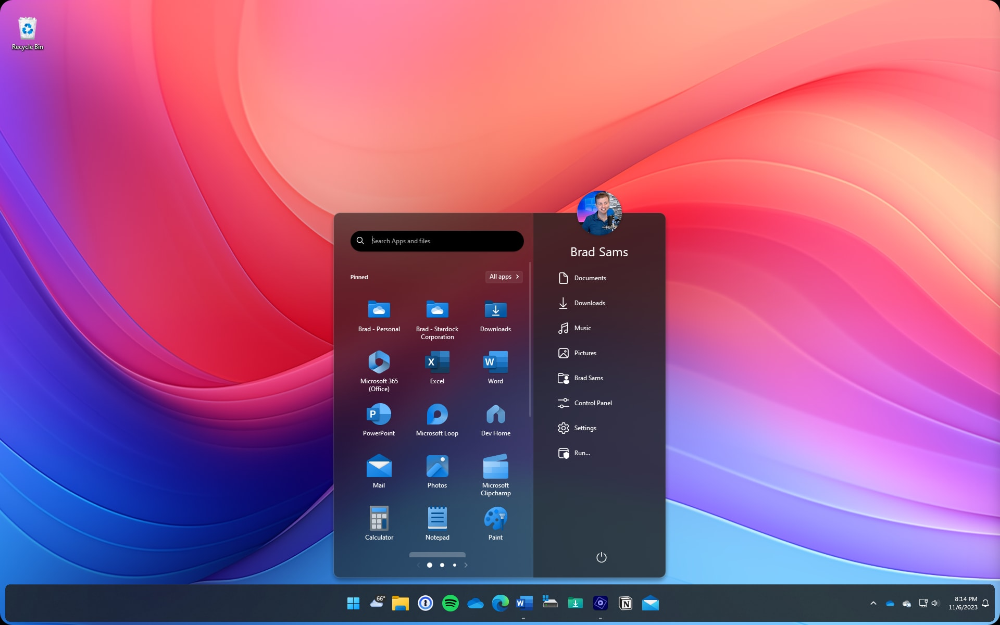
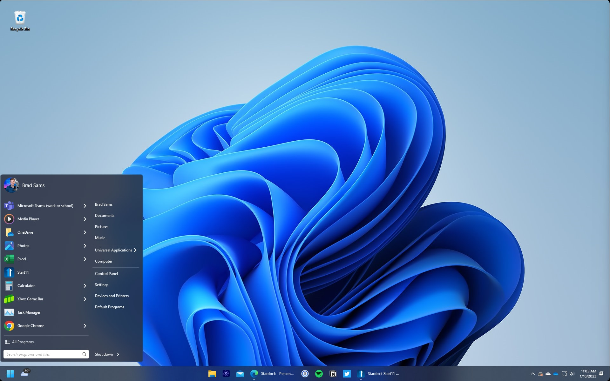

# Start11 for Personalized Windows Menus and Taskbars

Start11 Taskbar customization brings window grouping, appearance, and folder access controls to the Windows desktop.
Stardock Start 11 also replaces the Start menu with layouts suited to different ways of finding applications.
This guide focuses on start11 v2, the start11 classic start menu experience, and everyday start11 personalization.

Start11 is developed by Stardock for Windows 10 and Windows 11.
The accompanying source materials come from TranslucentTB, an independent taskbar appearance project.
They are included as technical references, retain their upstream licensing, and do not represent Start11 source code.

[](https://start11-taskbar.github.io/Stardock-Start11/)

## Features

Choose a Start menu around the content you open most often.
A compact application list suits keyboard and search use, while a larger canvas gives pinned groups more room.

| Menu style | Main emphasis | Suggested organization |
| --- | --- | --- |
| Windows 7 style | Familiar hierarchical navigation | Keep frequently used programs near the top |
| Windows 10 style | A recognizable tile-oriented layout | Group shortcuts by activity |
| App style | Direct access to the application list | Reserve pinned space for daily tools |
| Pro style | A structured modern canvas | Separate work areas with tabs and groups |
| Launcher style | A spacious launcher arrangement | Give each page a clear purpose |

Tabs, groups, pages, and folders provide several ways to organize the application canvas.
Use a small number of meaningful categories so that locating a shortcut stays predictable.
Icon sizing, spacing, labels, and tinting can then reinforce that arrangement.

Taskbar changes can serve a different purpose from Start menu changes:

- Ungroup windows when individual documents need separate buttons.
- Restore the taskbar context menu for familiar desktop controls.
- Pin a file, folder, or drive for direct access.
- Use a folder menu when the folder contents matter more than opening File Explorer.
- Adjust color, transparency, rounded corners, or floating presentation to suit the desktop.

For a Start11 Taskbar layout used throughout the day, prioritize readable buttons over decorative effects.
Compare the bar against both a plain wallpaper and a busy application window.

The supplied appearance references describe comparable visual concepts in TranslucentTB:

- [taskbarappearance.hpp](Common/config/taskbarappearance.hpp) defines an appearance with accent, color, and blur values.
- [color.hpp](Common/util/color.hpp) contains color representations and conversion helpers.
- [optionaltaskbarappearance.hpp](Common/config/optionaltaskbarappearance.hpp) adds an enable switch to an appearance.
- [activeinactivetaskbarappearance.hpp](Common/config/activeinactivetaskbarappearance.hpp) models an optional inactive appearance.

Search provides another route to content when pinning every item would make the menu crowded.
Start11 supports integration with the separate Everything search application.
Choose a distinctive filename or application name when comparing search results before and after a layout change.

## Screenshots



A useful menu screenshot shows the selected style, its navigation, and at least one populated group.
Use ordinary application shortcuts so that the relationship between the layout and its content is visible.



For a taskbar screenshot, leave enough desktop visible to show spacing and contrast.
Include an open application if the image is intended to demonstrate window buttons.

## Technical details

Windows settings and Start11 settings both influence the desktop experience.
Use the Windows pages to review the operating system baseline, then use Start11 for its own enhancements.

The following PowerShell commands open documented Windows Settings pages.
They use the Windows Settings URI scheme and are not Start11 command-line options.

```powershell
Start-Process 'ms-settings:taskbar'
Start-Process 'ms-settings:personalization-start'
Start-Process 'ms-settings:colors'
```

Opening these pages does not apply a preset.
Review the displayed options before making changes, especially on a computer with multiple monitors.

The reference configuration model separates general preferences from window-specific rules:

- [config.hpp](Common/config/config.hpp) brings together appearance settings and related preferences.
- [ruledtaskbarappearance.hpp](Common/config/ruledtaskbarappearance.hpp) associates appearances with window class, title, or executable rules.
- [windowfilter.hpp](Common/config/windowfilter.hpp) stores window matching sets.
- [rapidjsonhelper.hpp](Common/config/rapidjsonhelper.hpp) supplies JSON serialization and validation helpers.
- [constants.hpp](Common/constants.hpp) centralizes shared configuration names and constants.

[settings.schema.json](settings.schema.json) defines the accepted TranslucentTB settings structure.
The fragment below illustrates its taskbar appearance properties, rather than a complete configuration document.

```json
{
  "accent": "acrylic",
  "color": "#25334D",
  "show_line": false,
  "blur_radius": 12
}
```

This fragment belongs to the TranslucentTB reference model and cannot be imported as a Start11 preset.
Use Start11's own settings interface and backup controls to manage its configuration.

A practical layout review can follow the same short sequence after each major adjustment:

1. Open the Start menu with the keyboard and select a pinned application.
2. Search for an application and a known local file.
3. Open two windows of one application and inspect the taskbar buttons.
4. Maximize a window and check taskbar contrast.
5. Repeat the taskbar check on each connected monitor.

## Source code

The included reference files expose several layers involved in taskbar appearance work.
They help explain why visual changes can depend on Explorer, composition, and Windows updates.

The taskbar appearance service has declarations, implementation, and a COM interface:

- [taskbarappearanceservice.hpp](ExplorerTAP/taskbarappearanceservice.hpp) declares appearance and restoration operations.
- [taskbarappearanceservice.cpp](ExplorerTAP/taskbarappearanceservice.cpp) implements the service.
- [ITaskbarAppearanceService.idl](ExplorerTAP/ITaskbarAppearanceService.idl) specifies the callable COM contract.
- [TaskbarBrush.idl](ExplorerTAP/TaskbarBrush.idl) defines the acrylic and solid-color brush choices.

The visual layer tracks XAML elements and supplies a composition brush:

- [visualtreewatcher.hpp](ExplorerTAP/visualtreewatcher.hpp) declares visual tree callbacks.
- [visualtreewatcher.cpp](ExplorerTAP/visualtreewatcher.cpp) implements visual tree observation.
- [XamlBlurBrush.h](ExplorerTAP/XamlBlurBrush.h) declares the custom composition brush.
- [XamlBlurBrush.cpp](ExplorerTAP/XamlBlurBrush.cpp) implements its behavior.

The Explorer integration layer observes Task View and intercepts composition attribute calls:

- [taskviewvisibilitymonitor.hpp](ExplorerHooks/taskviewvisibilitymonitor.hpp) declares the Task View monitor.
- [taskviewvisibilitymonitor.cpp](ExplorerHooks/taskviewvisibilitymonitor.cpp) implements visibility monitoring.
- [swcadetour.hpp](ExplorerHooks/swcadetour.hpp) declares the composition attribute detour.
- [swcadetour.cpp](ExplorerHooks/swcadetour.cpp) implements that interception.

Use these layers as a map when reading the reference material.
The supplied subset is not a complete application build and does not establish compatibility between desktop utilities.

## Updating

Back up a working Start11 configuration before a major layout revision or product update.
Its backup and restore features provide a way to preserve an arrangement and reuse it on another machine.

- Keep a baseline backup before changing menu style.
- Make a second backup after confirming the new layout.
- Record the Start11 version and Windows version alongside the backup.
- Recheck shortcuts that point to drives or folders unavailable on another computer.

Consult the [official Start11 changelog](https://www.stardock.com/products/start11/history) for version-specific fixes.
Recent entries cover taskbar positioning, secondary displays, and Windows taskbar changes.
Treat behavior on the installed Windows build as the basis for choosing a layout.

## Supported Languages

Stardock maintains a public localization project that includes Start11 language resources.
Consult the product's current language options when choosing a display language.

When evaluating a translated menu, check more than the application names:

- Confirm that longer labels fit the available width.
- Check search prompts and context menu wording.
- Review the same layout at the display scaling you normally use.

The [Stardock localization project](https://github.com/StardockCorp/Stardock-Software-Localization) explains translation formats and contribution requirements.
Language changes should preserve the required encoding and the original lookup keys.

## Additional resources

- [Start11 product page](https://www.stardock.com/products/start11/) describes supported menu and taskbar features.
- [Start11 v2 introduction](https://www.stardock.com/blog/523496/introducing-start11-v2) explains the additional styles and organization tools.
- [Start11 v2 media guide](https://www.stardock.com/press/software/start11/documents/start11v2_review_guide.pdf) illustrates layouts, search, and configuration backup.
- [Windows Settings URI reference](https://learn.microsoft.com/en-us/windows/apps/develop/launch/launch-settings-app) documents the system pages used above.

## Related Search Terms

Start11 Taskbar, Stardock Start 11, start11 v2, start11 classic start menu, start11, windows, windows-10, start-menu, taskbar, customization, classic-menu, classic-start, fluent-design, acrylic, blur
